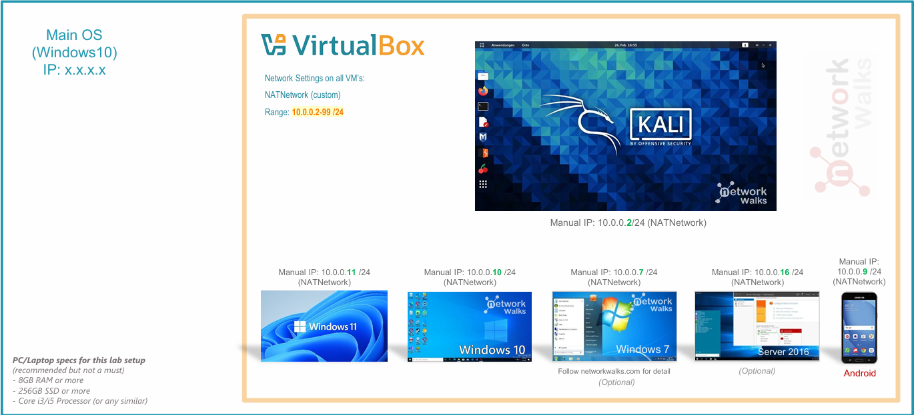
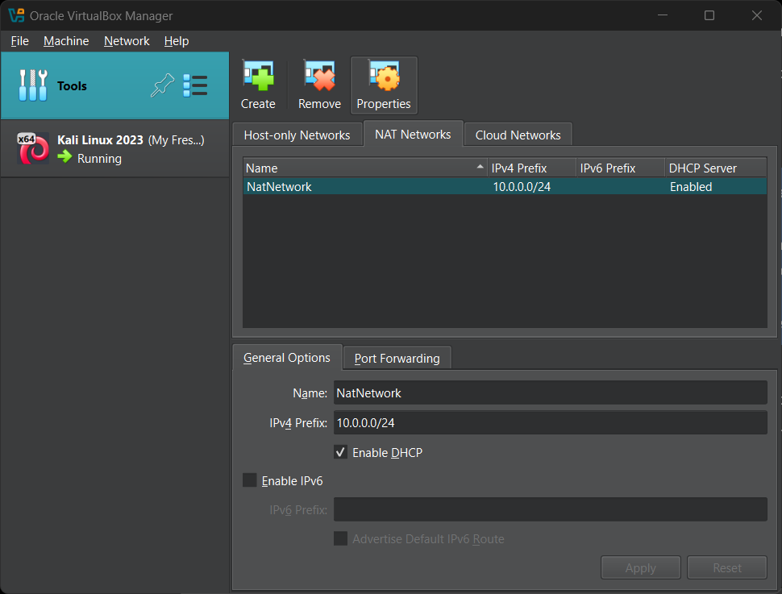
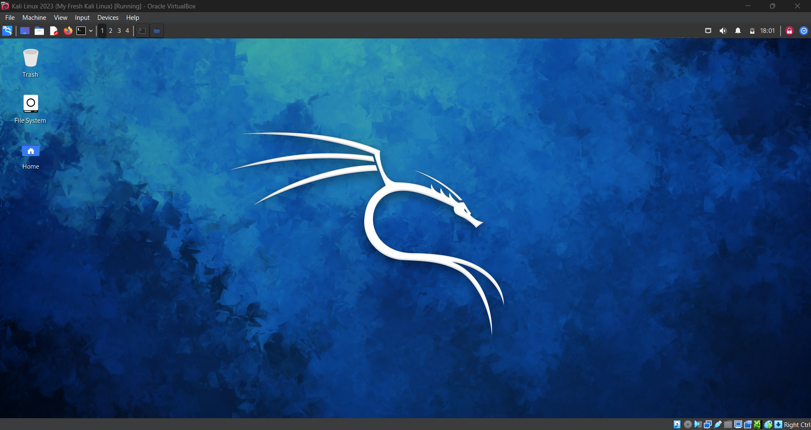
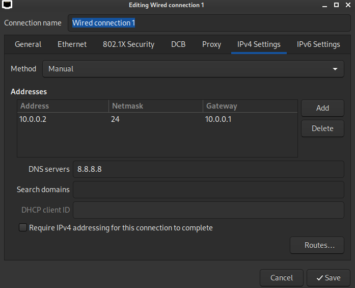
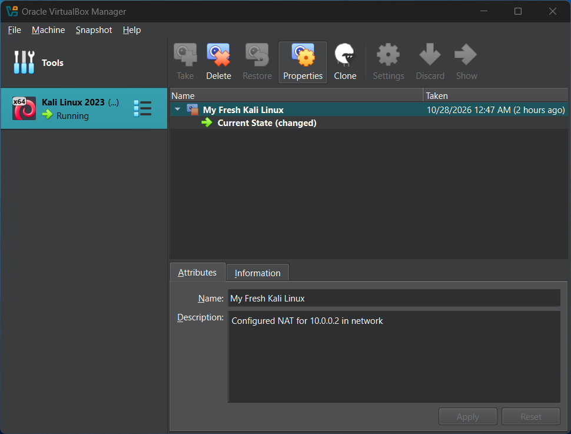
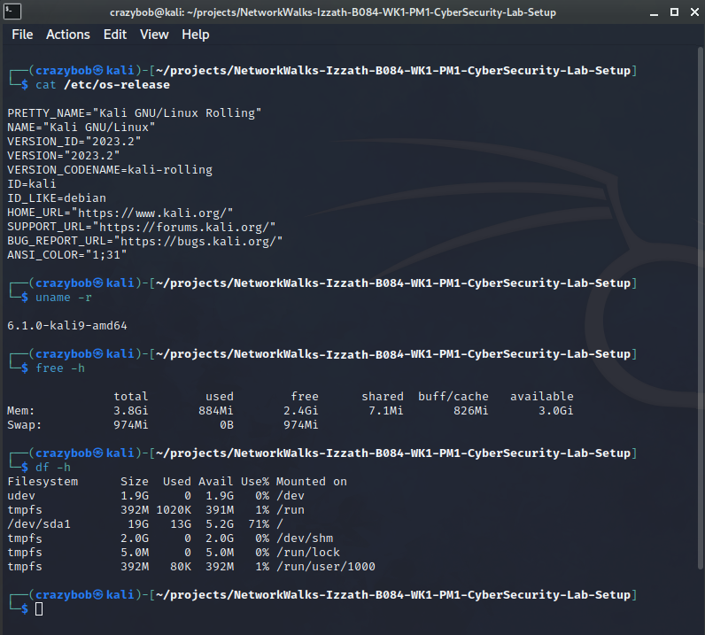
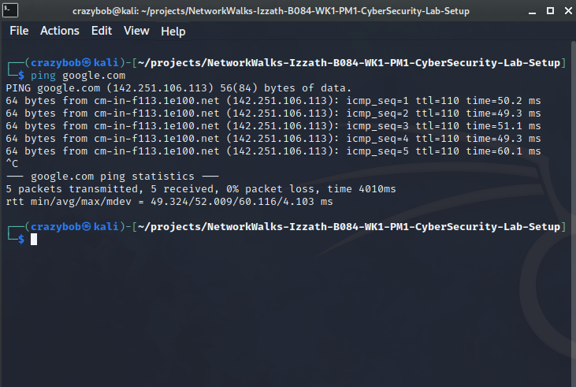

# 🔐 Cybersecurity Lab Environment Setup

Building a controlled virtual lab for cybersecurity learning, penetration testing, and ethical hacking practice.

## 📌 Project Overview

This project documents the setup of a beginner-friendly cybersecurity lab using Oracle VirtualBox and Kali Linux on a Windows 11 host computer.

The purpose of this lab is to establish a controlled virtual environment for learning cybersecurity fundamentals, practicing authorized security testing, and conducting future hands-on security projects.

The setup includes a dedicated VirtualBox NAT Network, Kali Linux network configuration, connectivity testing, and a clean virtual machine snapshot for recovery.

## 🎯 Objectives

- Install and configure Oracle VirtualBox.
- Import and run the Kali Linux virtual machine.
- Create a private NAT Network for the cybersecurity lab.
- Inspect and configure Kali Linux network settings.
- Verify network connectivity and DNS resolution.
- Take a clean VM snapshot for recovery.
- Document the lab setup process with screenshots.
- Prepare the environment for future cybersecurity projects and practical exercises.

## 🛡️ Purpose of the Lab

This lab provides a practical environment for developing foundational cybersecurity skills without conducting security experiments on unauthorized systems.

The environment will support future learning activities, including:

- Network security fundamentals.
- Linux system administration.
- Ethical hacking and authorized penetration testing.
- Digital forensics and evidence handling.
- Security monitoring and incident investigation.
- Hands-on cybersecurity portfolio development.

⚠️ Important: This laboratory must only be used for systems that you own or have explicit permission to test. Do not use the lab or its tools to attack unauthorized systems.

## 🏗️ Lab Architecture

The lab uses a Windows 11 host computer running Oracle VirtualBox, with Kali Linux operating as a guest virtual machine.

A dedicated VirtualBox NAT Network provides a separate virtual networking environment for future lab machines. Network isolation settings should be reviewed before introducing additional virtual machines or conducting security exercises.

### Lab Architecture Diagram



Additional target machines can be added to the same virtual network in future projects.

## ⚙️ Lab Configuration

| Component | Configuration |
|---|---|
| 🖥️ Host OS | Windows 11 |
| 🧠 Host RAM | 20 GB |
| ⚡ Processor | Intel Core i5 |
| 🧰 Hypervisor | VirtualBox 7.1.4 |
| 🐉 Security OS | Kali Linux 2023.2 |
| 🧠 Kali RAM | 4096 MB |
| 🌐 Virtual Network | NAT Network |
| 📡 Network Address | `10.0.0.0/24` |
| 🐧 Kali IP Address | `10.0.0.2/24` |
| 🚪 Default Gateway | `10.0.0.1` |
| 🌍 DNS Server | `8.8.8.8` |
| 🔮 Future VM Range | `10.0.0.3–10.0.0.99` |


## 🪜 Lab Setup Procedure

### Step 1: Install 7-Zip

Installed 7-Zip on the Windows 11 host computer to extract compressed files, including `.7z` archives, when preparing virtual machine installation files.

Download: [Official 7-Zip website](https://www.7-zip.org/)

### Step 2: Install Oracle VirtualBox

Installed Oracle VirtualBox on the Windows 11 host computer. VirtualBox allows Kali Linux to run inside a virtual machine without replacing the host operating system.

Download: [Official VirtualBox website](https://www.virtualbox.org/)

### Step 3: Create a Private NAT Network

Opened Oracle VirtualBox and created a dedicated NAT Network for the cybersecurity lab.

1. Opened VirtualBox's network configuration settings.
2. Createed a new NAT Network.
3. Assigned a suitable network name.
4. Reviewed the network address and DHCP settings.
5. Attached the Kali Linux virtual machine to the intended NAT Network.
6. Verified that the selected network configuration matches the lab requirements.



**Note:** A NAT Network provides virtual networking and outbound connectivity, but it should not automatically be considered a fully isolated security boundary. Review network connectivity and access settings before performing security experiments.

### Step 4: Import and Start Kali Linux

The Kali Linux virtual machine was downloaded from the [official Kali Linux website](https://www.kali.org/get-kali/) and imported into Oracle VirtualBox.

**Virtual Machine Network Configuration**

The VM network adapter was configured as follows:

```text
Adapter 1
Attached to:  NAT Network
Network:      NatNetwork
Adapter Type: Intel PRO/1000 MT Desktop
```

**Virtual Machine Resource Allocation**

```text
RAM: 4096 MB
```



### Step 5: Configure the Kali Linux Network

Inspected the Kali Linux network settings through the graphical network settings interface.

1. Opened the Kali Linux network settings.
2. Reviewed the available network interface and connection status.
3. Confirmed that the virtual machine is connected to the intended VirtualBox network.
4. Reviewed the network configuration and confirm that the connection is active.



### Step 6: Configure a Shared Folder

A VirtualBox shared folder was used to transfer screenshots and documentation between the Windows host and Kali Linux.

1. Created a folder on the Windows host for lab file transfers.
2. Opened the Kali Linux virtual machine's settings in VirtualBox.
3. Added the shared folder and select the appropriate host folder.
4. Enabled automatic mounting if required.
5. Confirmed that Kali Linux can access the shared folder.


### Step 7: Take a Clean VM Snapshot

A clean snapshot of the Kali Linux virtual machine provides a recovery point before performing cybersecurity lab exercises. It can help restore the VM to its saved state if a future experiment causes unexpected configuration changes.

The clean snapshot was created using Oracle VirtualBox's snapshot functionality.



**Verification:** The screenshot documents the Kali Linux virtual machine and its clean snapshot in Oracle VirtualBox. The snapshot can be used as a recovery point before future lab activities.

## 🔎 Lab Verification

The following checks were performed to confirm that the lab was operational.

### 1. System Information

The Kali Linux system information was inspected to confirm that the guest operating system was running.



### 2. Network Configuration

The graphical network settings were inspected to review the active network connection.


### 3. Network Connectivity

The following command was used to test connectivity to Google's domain:

```bash
ping google.com
```

This test sends four ICMP echo requests and displays the responses, if available. Resolving `google.com` to an IP address also exercises hostname resolution as part of the test.

A successful ping does not guarantee that every internet service is reachable, and a failed ping does not necessarily indicate a DNS failure because ICMP traffic may be filtered.



### 4. Web Browser Verification

Mozilla Firefox was opened in Kali Linux, and Google was accessed to check browser-based connectivity.

Together, the ping test and browser check provide basic evidence of network functionality.

## 🐞 Problems Encountered & Solutions

During lab setup and verification, the following troubleshooting approaches are useful when issues arise.

| Potential problem                   | Troubleshooting approach                                                                       |
| ----------------------------------- | ---------------------------------------------------------------------------------------------- |
| Compressed file cannot be extracted | Confirm that 7-Zip is installed and the downloaded archive is complete.                        |
| Kali Linux does not start           | Review the VM configuration and confirm that the virtual machine image was imported correctly. |
| Network connection is unavailable   | Check the VirtualBox network attachment and Kali Linux network settings.                       |
| Domain connectivity test fails      | Check the connection status, hostname resolution, and whether ICMP traffic is filtered.        |
| Shared folder is inaccessible       | Review the VirtualBox shared-folder configuration and guest permissions.                       |
| VM configuration becomes unstable   | Use the clean snapshot as a recovery point, after considering any changes that would be lost.  |

These are troubleshooting references for the lab. They should not be interpreted as a claim that every listed problem occurred during setup.

## 💡 What I Learned

Through this project, I developed practical familiarity with:

- Preparing a virtualization environment on Windows 11.
- Importing and running Kali Linux in Oracle VirtualBox.
- Creating a dedicated NAT Network for cybersecurity lab use.
- Inspecting Linux network settings and testing basic connectivity.
- Using a web browser to check network access.
- Creating and documenting a clean virtual machine snapshot.
- Organizing project screenshots and technical documentation for GitHub.
- Preparing a foundation for future cybersecurity practice and portfolio projects.

## 🔐 Security & Ethical Use

This lab is intended for educational purposes and authorized security testing.

- Perform security testing only on systems you own or have explicit permission to assess.
- Use isolated lab environments when conducting potentially disruptive exercises.
- Review virtual network connectivity before introducing additional lab machines.
- Keep a clean VM snapshot available before making significant changes.
- Do not store passwords, private keys, personal information, or other sensitive data in the public repository.
- Follow applicable laws, organizational policies, and responsible disclosure practices.

## 🔗 Tools & Resources

- [Oracle VirtualBox](https://www.virtualbox.org/) — Virtualization platform.
- [Kali Linux](https://www.kali.org/) — Linux distribution for cybersecurity and penetration testing.
- [7-Zip](https://www.7-zip.org/) — File archiving and extraction utility.
- [GitHub](https://github.com/) — Source control and portfolio hosting.
- [Kali Linux Documentation](https://www.kali.org/docs/) — Official installation and usage documentation.

## 👤 Author

**Izzath Inayathullah**

Cybersecurity learner building practical skills through hands-on labs, technical documentation, and security-focused portfolio projects.

GitHub: [IzzathInayathullah](https://github.com/IzzathInayathullah)

## 📌 Project Information

- **Project:** Cybersecurity Lab Environment Setup
- **Repository:** `NetworkWalks-Izzath-B084-WK1-PM1-CyberSecurity-Lab-Setup`
- **Project type:** Beginner cybersecurity home lab
- **Environment:** Windows 11, Oracle VirtualBox, and Kali Linux
- **Focus areas:** Virtualization, network configuration, connectivity verification, and snapshot-based recovery
- **Status:** Lab setup documentation and verification

This project establishes a foundation for future cybersecurity labs, practical exercises, and GitHub portfolio development.
